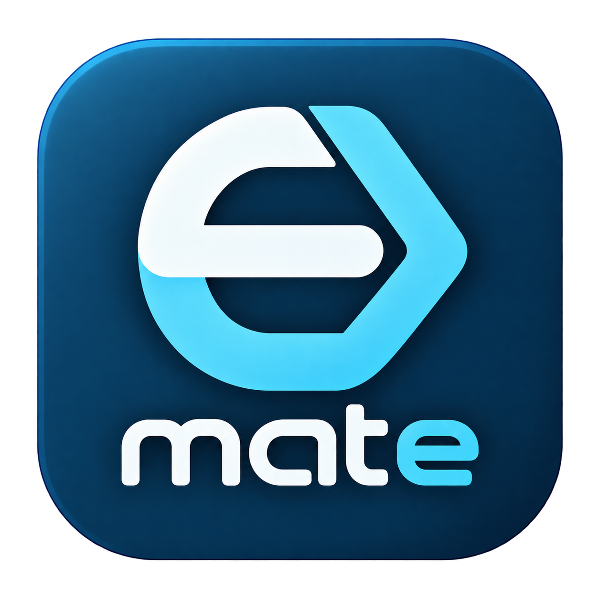
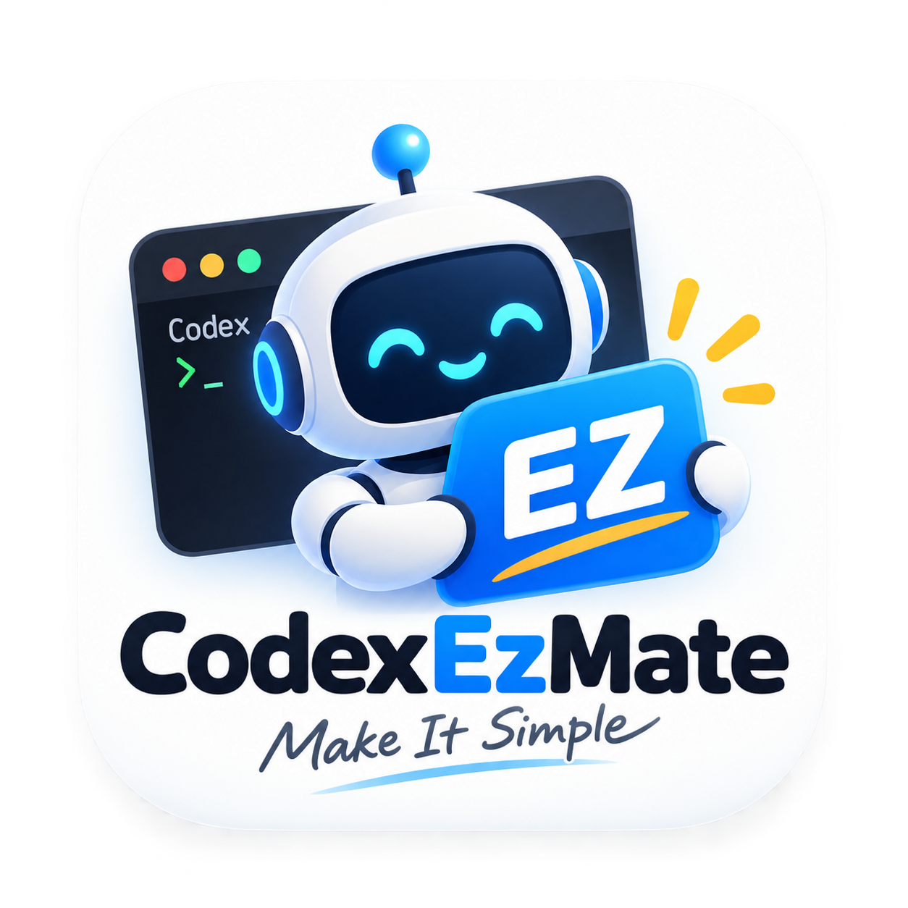
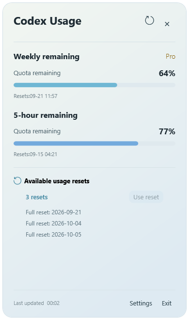
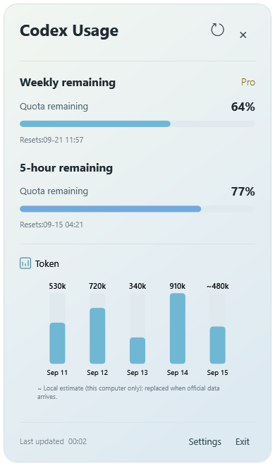
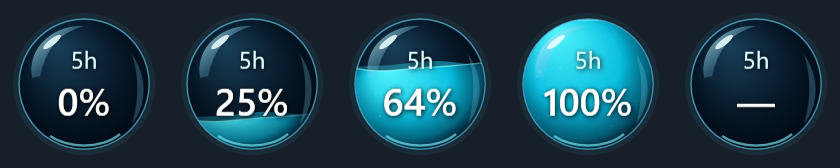
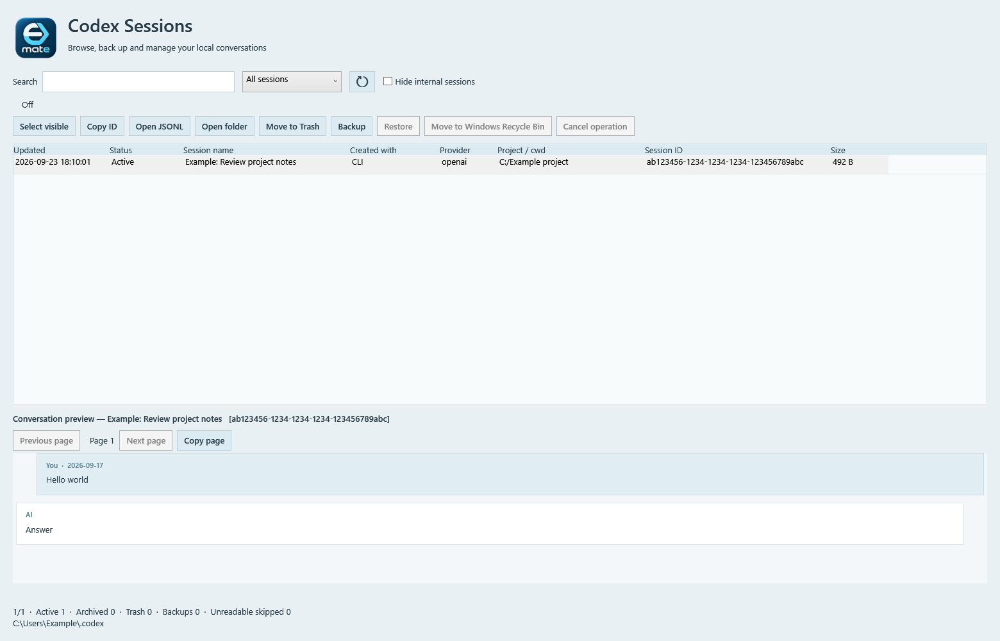
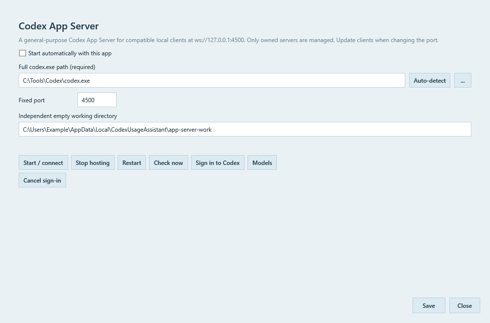

<p align="center">
  
</p>

# Codex EzMate

**English** · [繁體中文](README.zh-Hant.md) · [简体中文](README.zh-Hans.md)

**Reset alerts. Batch session management. Automatic Goal recovery. Standalone usage monitoring and reset control.**

A Windows tray companion that keeps these everyday Codex tasks in one place.

**Current source version: 1.21.9** · Windows x64 · .NET 8 / WPF · Traditional Chinese / Simplified Chinese / English

[Download](https://github.com/lkamhk/CodexEzMate/releases) · [Report an issue](https://github.com/lkamhk/CodexEzMate/issues)

## What’s new in 1.21.9

- **Floating Session Browser shortcut:** a monochrome E + mate icon follows the foreground Codex desktop window, including the new-chat screen. Click to open or restore Session Browser.
- **Position controls:** drag the icon to reposition it; right-click to reset or hide it. Re-enable it from the EzMate tray menu. Position and visibility are saved.
- **Window awareness:** the icon follows movement and DPI changes and hides when Codex is minimized or another app is in front. It is an EzMate overlay, not a modification to Codex’s toolbar.
- **Single-instance activation:** `CodexEzMate.exe --session-browser` opens the existing browser window instead of starting another background instance.

Exit an older EzMate before upgrading. In desktop versions where ChatGPT, Work and Codex share a window, the icon follows that shared window. [Usage details](docs/toolbar-floating-icon.md).

## Four core features

| | What you can do |
| --- | --- |
| **🔔 Reset release alerts** | Follow reset previews and release announcements from a trusted feed, with notifications for new or revised notices. Separately, get notified when your account’s available reset count increases. |
| **🗂️ Batch session management** | Select multiple conversations to back up, move to Trash, restore, or send trashed files to the Windows Recycle Bin. Search, preview user/AI messages, and optionally name sessions automatically. |
| **▶️ Automatic Goal recovery** | Resume selected Goals that stopped because of quota limits once account usage becomes available again. Continue in the original Codex Desktop conversation. **Successfully tested in real use by the maintainer.** |
| **💧 Standalone usage monitoring & reset control** | **No need to open Codex Desktop** to monitor 5-hour/weekly quotas or view available resets and expiry dates. Redeem an available reset after confirmation, directly from EzMate. |

**Requirements:** standalone usage and reset control use an installed, signed-in Codex executable; reset availability depends on the account data returned. Public reset alerts require a configured, enabled HTTPS feed and do not prove a reset has reached your account. **Goal recovery requires Codex Desktop to remain open** and sends a continuation message that consumes tokens and usage quota.

**Manual updates:** download and install new versions from Releases. Automatic application updates are not enabled.

> **Goal resume has been successfully tested in real use by the maintainer.** Goal monitoring remains experimental, and feedback is welcome. It sends a continuation message and **consumes tokens and Codex usage quota**. Automatic session naming uses local rules and does **not** consume tokens.

This is a third-party project, not an official OpenAI product.

[What’s new](#whats-new-in-1215) · [Get started](#installation-and-first-use) · [Session Browser](#session-browser) · [Goal monitoring](#goal-monitoring) · [Server hosting](#server-hosting) · [Build from source](#running-from-source)

<p align="center">
  
</p>

## Screenshots

These screenshots show the English interface with example usage, conversations, and paths, rather than real account data. Click an image to view it at full size.

| Usage overview and available resets | Daily token activity |
| :---: | :---: |
| [](assets/screenshots/usage-overview-en.png) | [](assets/screenshots/token-activity-en.png) |

## Features

| Feature | Description |
| --- | --- |
| Usage overview | View remaining 5-hour and weekly quotas, reset times, and your account plan. |
| System tray and floating widget | Keep the notification area icon, with an optional floating widget. The tray icon can display the remaining percentage, falling back to weekly quota when 5-hour data is unavailable. |
| Reset / Token / Credit | Hover to reveal navigation arrows. View reset expiry dates, daily token bars, and credit information. |
| Use a reset | Consume one reset after confirmation, prioritizing the earliest-expiring valid item in the returned details, then refresh usage. |
| Session Browser | Browse user/AI conversation cards, identify the creating app, search, back up, and restore sessions. Move unwanted sessions to the app’s Trash, then optionally to the Windows Recycle Bin. |
| Automatic session naming | Optional, rule-based titles from the first and latest user prompts. Supports per-session exclusions; no AI requests or token usage. |
| Reset notifications | Receive a notification when a fresh reading shows an increase in available resets. |
| Reset activity | Read public reset announcements from a trusted HTTPS feed, with source status, cached results, and configurable notifications. Disabled until configured and enabled. |
| Goal monitoring | **Experimental — available for testing.** Resume selected usage-limited Goals in the original Codex Desktop conversation. Sends a continuation message and consumes tokens and usage quota. |
| Server hosting | Start or reuse a local Codex App Server, with sign-in, connection status, restart controls, and recovery after unexpected exits. |
| Global shortcuts | Assign shortcuts to open Session Browser, Goal monitoring, Server host, usage details, settings, and other windows. |
| Usage refresh and preferences | Scheduled and event-triggered usage refresh, proxy settings, and three interface languages. Refreshing usage is separate from updating the application. |

## What's new in 1.21.5

Version 1.21.5 includes the changes below. Application updates remain manual; available packages are listed under Releases.

- **Automatic naming and exclusions:** a tray-menu switch, persistent exclusions by session ID, and checks before queued name changes are written.
- **A cleaner Session Browser:** user/AI conversation cards, a **Created with** column, a refresh icon, and a separate action to move trashed sessions to the Windows Recycle Bin.
- **A glass-style floating widget:** animated cyan waves and stronger depth, with no taskbar button. Animation runs at up to 20 FPS and stops when the widget is hidden.
- **Reset activity:** a separate feed reader for public announcements, with configurable notifications and persistent deduplication. It does not redeem resets or directly resume Goals.
- **New-reset notifications:** display the increase and current total without notifying on the initial reading or repeated updates. Windows notification settings may affect visibility.
- **Clearer settings and branding:** simpler data-source labels and a transparent “mate” logo.



<details>
<summary>Memory improvements introduced in 1.21.4</summary>

- Session Browser previews load in 64K-character pages with a small bounded cache.
- Token statistics and Goal observation read newly appended records instead of repeatedly scanning entire files.
- Usage reads and notifications share a connection; compatible EzMate-owned App Servers can be reused.
- Closing windows releases their resources explicitly. The application does not periodically force garbage collection or trim its working set.
- Includes the new app icon, larger “mate” logo, and promotional artwork.

In a development benchmark with fixed synthetic conversations and 20 Session Browser open/close cycles, peak main-process working set decreased from **302.7 to 203.8 MiB**, and peak private bytes from **228.7 to 127.1 MiB** compared with 1.21.3. These are controlled Debug/WPF measurements, not guaranteed memory usage for every installation; enabled features, conversation size, and child processes affect actual usage.

</details>

## Installation and first use

1. Download an available installer, `Codex-EzMate-<version>-Setup.exe`, or portable package, `Codex-EzMate-win-x64.zip`, from [Releases](https://github.com/lkamhk/CodexEzMate/releases). If no package is available yet, follow the source instructions below.
2. The installer defaults to `%LOCALAPPDATA%\Programs\Codex EzMate` for the current user, creates a Start menu shortcut, and offers an optional desktop shortcut. For the portable edition, extract the **entire ZIP** to a writable folder and launch the top-level `CodexEzMate.exe`. Keep the `app/` folder in place for either edition.
3. Run under the same Windows account where Codex is installed and signed in. The package does not include `codex.exe`; EzMate attempts to detect its path, or you can set it manually.
4. Click the tray icon to view usage. Right-click → **Settings → Basic settings** to choose the data source and refresh interval; the **Display** tab controls language and the floating widget.
5. If the local account needs authentication, open **Server host** and use **Sign in to Codex**. For website account sign-in, use **Sign in / Get usage** from the tray menu.

Server hosting is optional for ordinary usage viewing. Enable it when another local client needs a persistent App Server endpoint; see [Server hosting](#server-hosting).

Website account sign-in requires Microsoft Edge WebView2 Runtime.

### Data sources and usage

Under **Settings → Basic settings**, choose:

- **Automatic (recommended)** — local Codex first, with website account sign-in as fallback.
- **Local Codex account** — use the account signed in on this computer.
- **Website account sign-in** — shows **Sign in / Get usage** in the right-click menu.

Available information depends on the Codex version, account, and fields returned by the backend. Missing data appears as “—” or an explanatory message; it does not mean usage is zero. Local Codex and website sign-in may be signed in to different accounts, so check which account you are using.

The token chart shows recent daily records. When official data does not yet include today, local conversation token records may provide an estimate marked with `~`. This covers records on this computer only and is not the official account-wide total.

**Use reset** requires App Server to return an available reset. Confirming the action consumes one reset. Credit values are displayed as returned by the backend, without converting them into currency or tokens.

### Reset activity

Open **Reset activity** from the tray menu or the usage details window. This shows public announcements and source status; it is separate from your account’s available reset count.

1. Open **Feed settings**, enter a trusted **HTTPS JSON feed URL**, enable the feature, and save. No feed URL is bundled or enabled by default.
2. Choose a polling interval from 5 to 60 minutes (default: 5). You can also refresh manually. Failed checks back off automatically.
3. Choose which announcement types should notify you. Community-report notifications are off by default. Account-reset notifications have their own switch.

The first successful reading of a new URL or feed identity establishes a baseline without replaying historical notifications. Seen event revisions and cached results survive restarts. Open **Details** for longer announcement text, or follow the source link to read the original notice.

**A public announcement does not mean your account has received a reset.** Source classifications are supplied by the feed publisher. Eligible announcements may request a fresh account-usage check, but the feed reader does not redeem resets or directly start/resume a Goal. Any enabled Goal monitor still makes its own quota check.

EzMate does not send Codex credentials, account IDs, conversation content, or usage data to the feed. The feed host can still see normal connection information such as your IP address. Do not put secrets in the feed URL.

See the [receiver guide](docs/reset-watch.md) and [feed API contract](docs/reset-feed-api.md) for feed integration details (Chinese).

### Global shortcuts

Open **Keyboard shortcuts** from the right-click menu, select modifiers and a key, then save. Changes take effect immediately.

- Use Ctrl, Alt, or Win with a letter, digit, or F1–F11. Shift can be added.
- All shortcuts are unassigned by default. For example, you can assign `Ctrl + Alt + S` to Session Browser.
- Disable all shortcuts while keeping their assignments, or choose **Unassigned** to clear one.
- Duplicate or unavailable combinations produce an error. EzMate must remain running for its shortcuts to work.

### Session Browser

[](assets/screenshots/session-browser-en.png)

Choose **Open Session Browser** from the tray menu.

- Search sessions, copy IDs, open the original JSONL or its folder, and create backups.
- **Created with** identifies Codex Desktop, VS Code, or CLI from session metadata. Missing or ambiguous metadata appears as **Unknown**.
- **Hide internal sessions** filters the list without deleting anything.
- Preview cards show user and AI messages, filtering recognized system instructions, internal messages, reasoning, and tool records. Original conversation files are unchanged.
- Use **Previous page**, **Next page**, and **Copy page** for previews of up to 64K characters per page. Preview size and message-count limits still apply; **Open JSONL** provides access to the full record.

The browser follows the app’s language immediately. Reopening it brings the existing window forward. During file operations, closing the browser or exiting EzMate waits until the operation finishes or the remaining work is cancelled safely.

#### Automatic session naming

Turn on **Automatically name sessions** in the **tray’s main right-click menu**. It is **off by default**, and your choice is saved.

After a newly completed AI reply, EzMate updates the **original Codex session name**, which is also shown in Session Browser:

```text
First user prompt | Latest user prompt
```

Each side contains up to 30 visible characters, with `…` appended when longer. Line breaks and repeated whitespace become spaces; a single user prompt appears once. Recognized injected and internal content is excluded. The feature uses local rules, makes no AI requests, and consumes no tokens.

- Enabling the feature or restarting EzMate does not bulk-rename existing history. It waits for a new completed reply.
- Right-click a session and choose **Exclude from automatic naming** to keep its current name. Exclusions are saved by session ID and survive renaming and restarts.
- Choose **Restore automatic naming** to resume updates after the next completed reply; old queued updates are not replayed.
- Queued changes are checked again before writing. If an already-sent request has an uncertain outcome, EzMate reports it and pauses further renames for that session until confirmed.
- Naming continues while Session Browser is closed, as long as EzMate remains running. Archived, trashed, backup, and internal sessions are not automatically renamed.

#### Trash and recovery

**Move to Trash** moves a session into EzMate’s own recoverable storage. Use **Restore** to return it; an existing destination file is never overwritten.

To remove sessions from the app’s Trash, select them and choose **Move to Windows Recycle Bin**, then confirm. Their restore metadata is moved with them. To recover them later, restore **both the conversation and its metadata** from the Windows Recycle Bin, refresh Session Browser, then use **Restore** in EzMate.

### Goal monitoring

> **Available for experimental testing — feedback is welcome!** The original Codex Desktop can remain open or minimized while EzMate requests continuation in the same conversation.

**Token and quota usage:** This feature sends an automatic continuation message to the original conversation. Processing the message and subsequent Goal execution consume tokens and Codex usage quota. Enable it only for conversations you want to continue.

1. Keep Codex Desktop open, then open **Goal monitoring** from the tray menu and scan local conversations.
2. Select the conversations you want to monitor and choose **Start monitoring**. Automatic recovery targets only selected Goals stopped by quota exhaustion, after App Server reports quota is available.
3. To try it with a non-critical, manually paused Desktop Goal, select it and choose **Continue selected paused Goal**.
4. Check progress and respond to approval or input requests in the original Desktop conversation. EzMate distinguishes queued messages from confirmed execution and avoids automatically resending uncertain requests after disconnection or restart.

Use **Stop monitoring** to stop taking on new recoveries. **Cancel recovery / pause continuation** handles an outstanding EzMate recovery and pauses further Goal continuation; stop an already running turn in the original Desktop. Exiting EzMate leaves Desktop work running.

**Validation:** the maintainer has confirmed successful Goal resume in real use. Earlier tests also covered continuation in the original Desktop, multiple turns, preserved Goal usage records, and minimized operation without foreground interference. This does not establish coverage of every quota-restoration path or Codex version. **Goal recovery through CLI and VS Code is not yet verified**; recognizing their sessions in Session Browser does not imply recovery support. Avoid editing or resuming the same Goal simultaneously in multiple clients.

Please [report feedback or problems](https://github.com/lkamhk/CodexEzMate/issues) with your EzMate and Codex versions, Goal status, steps to reproduce, and expected versus actual behavior. Remove account details, credentials, and private conversation content before sharing logs or screenshots.

### Server hosting

[](assets/screenshots/server-host-en.png)

The default endpoint is `ws://127.0.0.1:4500`, for compatible clients on the same computer. The server runs in the background without an extra console window and uses a separate working folder.

- Reuses an existing server that completes the protocol handshake. Reports an error if another service occupies the port.
- Manages only processes it starts. Exiting EzMate leaves reused external servers running.
- Restarts its own server after unexpected exits, retrying after 2, 5, 15, 30, and 60 seconds, then every 60 seconds.
- Uses Codex's saved authentication. You do not need to enter an API key into EzMate.

The separate working folder avoids inheriting another project's context. **It does not enable a “no conversation history” mode**; the connecting client determines whether to create an ephemeral thread.

**Suggested companion: [Saladict EzMate](https://github.com/lkamhk/saladict-ezmate-) for using Codex for translation.** If you use its Codex App Server integration, set the endpoint to `ws://127.0.0.1:4500` and let Codex EzMate host the server in the background, without opening a terminal each time. See that project's README for installation and configuration.

### Application updates

**Current releases do not automatically check for, download, or install newer application versions.** Download updates manually from [GitHub Releases](https://github.com/lkamhk/CodexEzMate/releases).

Exit EzMate normally before updating. For the installer edition, run the new Setup file. For the portable edition, preserve your settings and conversation backups before replacing application files.

Scheduled usage refresh and server-notification refresh remain available; disabling application updates does not affect them.

## Running from source

Requires Windows x64, the .NET 8 SDK, and network access to restore NuGet packages. Session Browser builds with the main application. Python, Nuitka, and C++ build tools are not required.

```powershell
git clone https://github.com/lkamhk/CodexEzMate.git
cd CodexEzMate
dotnet run --project src/CodexUsageAssistant.App/CodexUsageAssistant.App.csproj -c Debug
```

This restores dependencies, builds, and starts the Debug version. Exit any running Debug instance before rebuilding. To build without launching:

```powershell
dotnet build src/CodexUsageAssistant.App/CodexUsageAssistant.App.csproj -c Debug
```

Run tests:

```powershell
dotnet test tests/CodexUsageAssistant.Tests/CodexUsageAssistant.Tests.csproj -c Debug
```

## Reference projects

- [CodexMeter](https://github.com/raycalrui/CodexMeter)
- [CodexQuotaTray](https://github.com/SYD-Official/CodexQuotaTray)

## Third-party resources

Some interface icons use Microsoft Fluent UI System Icons. See the [Fluent UI license](src/CodexUsageAssistant.App/Assets/fluent/LICENSE.txt). Other dependencies are subject to their respective licenses.
