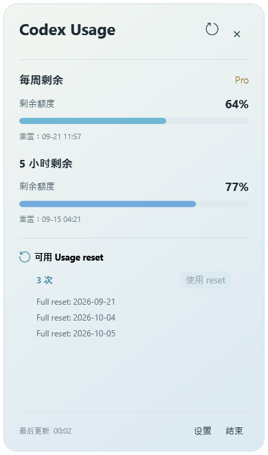
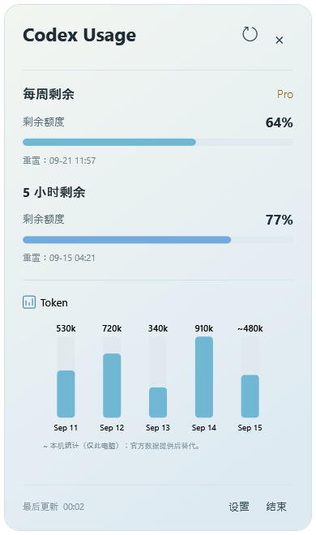

# Codex EzMate

[English](README.md) · [繁體中文](README.zh-Hant.md) · **简体中文**

**当前源代码版本：1.22.7** · Windows x64 · .NET 8 / WPF · 繁体中文／简体中文／English

[下载版本](https://github.com/lkamhk/CodexEzMate/releases) · [反馈问题](https://github.com/lkamhk/CodexEzMate/issues)

## 四大核心功能

| | 你可以做什么 |
| --- | --- |
| **🔔 Reset 发布通知** | 从可信公告来源跟踪 Reset 预告及发放消息，新公告或修订可通知你；账户实际可用 reset 次数增加时，也会另行通知。 |
| **🗂️ 批量会话管理** | 多选会话，批量备份、移至回收区、还原，或将回收区文件送到 Windows 回收站。支持搜索、用户／AI 对话预览及可选的自动命名。 |
| **▶️ Goal 自动恢复任务** | 已勾选的 Goal 因额度不足停止后，确认账户额度恢复即可在原 Codex Desktop 对话继续工作。**维护者已实测成功恢复。** |
| **💧 独立用量监控与 Reset 控制** | **无需打开 Codex Desktop App**，即可查看 5 小时／每周额度、可用 reset 次数及到期时间，并在 EzMate 内确认使用 reset。 |

## 界面预览

| 用量概览与可用 reset | 每日 Token 图表 |
| :---: | :---: |
|  |  |
