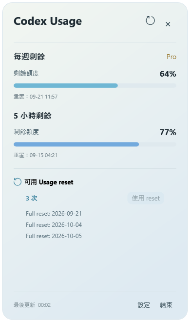
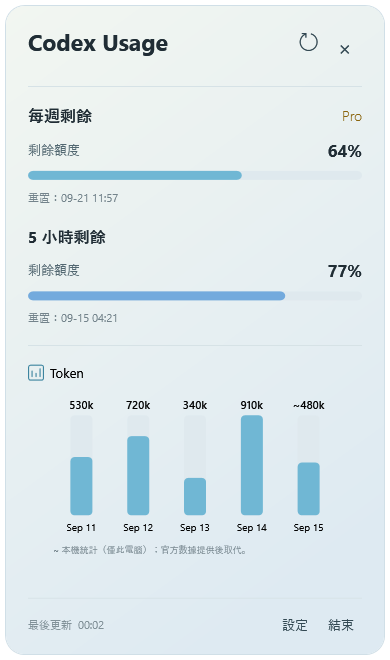

# Codex EzMate

[English](README.md) · **繁體中文** · [简体中文](README.zh-Hans.md)

**目前原始碼版本：1.22.7** · Windows x64 · .NET 8 / WPF · 繁體中文／簡體中文／English

[下載版本](https://github.com/lkamhk/CodexEzMate/releases) · [回報問題](https://github.com/lkamhk/CodexEzMate/issues)

## 四大核心功能

| | 你可以做甚麼 |
| --- | --- |
| **🔔 Reset 發佈通知** | 從可信公告來源追蹤 Reset 預告及發放消息，新公告或修訂可通知你；帳戶實際可用 reset 次數增加時，亦會另行通知。 |
| **🗂️ 批量會話管理** | 多選會話，批量備份、移至回收區、還原，或把回收區檔案送到 Windows 資源回收筒。支援搜尋、用戶／AI 對話預覽及選擇性自動命名。 |
| **▶️ Goal 自動恢復任務** | 已勾選的 Goal 因額度不足停止後，確認帳戶額度恢復即可在原 Codex Desktop 對話繼續工作。**維護者已實測成功恢復。** |
| **💧 獨立用量監控與 Reset 控制** | **毋須開啟 Codex Desktop App**，即可查看 5 小時／每週額度、可用 reset 次數及到期時間，並在 EzMate 內確認使用 reset。 |

## 介面預覽

| 用量概覽與可用 reset | 每日 Token 圖表 |
| :---: | :---: |
|  |  |
